# Willkommen!

Der **Lauftrainer** ist dein freundlicher, virtueller Trainer auf dem **iPad**. Er hilft dir, ganz entspannt mit dem Laufen anzufangen oder dranzubleiben – mit Gehpausen, kleinen Kraft- und Yoga-Einheiten und genug Erholung.

Der Lauftrainer ist eine **Web-App**: Du öffnest ihn einmal in Safari und legst ihn dann wie eine normale App auf deinen Home-Bildschirm. Es gibt kein Benutzerkonto. **Alle deine Daten bleiben auf deinem iPad.**

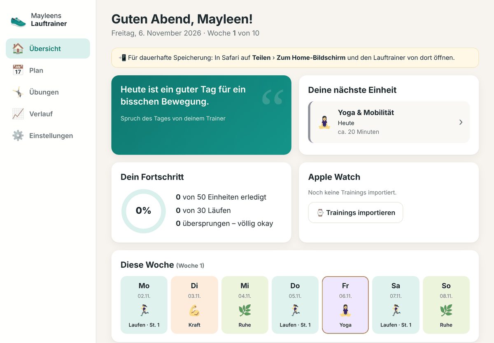

## Was der Lauftrainer kann

- **Übersicht** mit persönlicher Begrüßung, deiner nächsten Einheit, dem Wochenplan und deinem Fortschritt.
- **10-Wochen-Plan für Einsteigerinnen**: dreimal pro Woche Laufen & Gehen, dazu Kraft & Gleichgewicht, Yoga & Mobilität und zwei Ruhetage.
- **Aufbau danach**: Schritt für Schritt bis **5 km**, dann **10 km** und schließlich **15 km** am Stück.
- **Rückmeldung nach jeder Einheit** („leicht“, „passend“, „zu anstrengend“). Der Plan passt sich daran vorsichtig an.
- Einheiten als **erledigt, übersprungen oder verschoben** markieren – ohne schlechtes Gewissen.
- **Intervall-Timer** mit Signalton und Ansage für die Lauf-/Geh-Wechsel.
- **Übungsbibliothek** mit 20 Übungen (Kraft, Gleichgewicht, Mobilität, Yoga) mit Anleitung, Tipps und leichteren Varianten.
- **Täglicher Motivationsspruch** deines Trainers (über 60 Sprüche).
- **Apple-Watch-Trainings** übernehmen (freiwillig) – über die App HealthFit und iCloud Drive.
- **Sichern, Wiederherstellen und Löschen** deiner Daten.
- Funktioniert **ohne Internet**, sobald er einmal geöffnet wurde.

## Was der Lauftrainer nicht kann

- Er ist **kein medizinisches Produkt**. Er stellt keine Diagnosen und gibt keine medizinischen Ratschläge. Wenn du gesundheitliche Fragen hast, Schmerzen bekommst oder unsicher bist, sprich bitte mit deiner Ärztin oder deinem Arzt.
- Er greift **nicht direkt** auf die Health-App oder die Apple Watch zu. Trainings kommen nur dann hinein, wenn du die Dateien selbst auswählst.
- Er **gleicht nicht** zwischen mehreren Geräten ab. Die Daten liegen nur auf diesem einen iPad.
- Er enthält keine Videos. Du kannst aber zu jeder Übung einen eigenen Videolink speichern.

# Voraussetzungen

| Was | Details |
|---|---|
| Gerät | iPad mit iPadOS 16.4 oder neuer (Safari) |
| Internet | Nur beim ersten Öffnen und für hinterlegte Videolinks |
| Speicher | weniger als 1 MB |
| Apple Watch (optional) | Apple Watch mit iPhone und der App **HealthFit** (einmaliger Kauf im App Store, kein Abo) |

> **Für Klaus (Einrichtung):** Die App besteht nur aus statischen Dateien (HTML, CSS, JavaScript). Sie muss einmal über **HTTPS** erreichbar sein, damit Safari sie als App installieren kann – siehe Kapitel *Bereitstellen*. Dabei werden keine Trainingsdaten übertragen; der Server liefert nur die Programmdateien aus.

# Auf dem iPad einrichten

## 1. In Safari öffnen

1. Öffne **Safari** auf dem iPad.
2. Gib die Adresse des Lauftrainers ein (bekommst du von Klaus).
3. Die Willkommensseite erscheint.

## 2. Zum Home-Bildschirm hinzufügen – wichtig!

1. Tippe oben in Safari auf **Teilen** (Quadrat mit Pfeil nach oben ⬆︎).
2. Wähle **„Zum Home-Bildschirm“**.
3. Der Name **„Lauftrainer“** ist schon eingetragen. Tippe auf **„Hinzufügen“**.
4. Schließe Safari und öffne den Lauftrainer **über das neue Symbol** auf dem Home-Bildschirm.

> **Warum ist das wichtig?** Die App auf dem Home-Bildschirm hat einen **eigenen, dauerhaften Speicher**. In Safari selbst kann das iPad Website-Daten löschen, wenn eine Seite länger nicht benutzt wird. Richte den Lauftrainer deshalb **erst im Home-Bildschirm-Symbol** ein, nicht in Safari. Solange du in Safari bist, zeigt dir der Lauftrainer einen gelben Hinweis.

## 3. Erster Start

Beim ersten Start fragt dich der Trainer nach deinem Namen und dem Starttag. Der Plan beginnt mit dem Montag der gewählten Woche und dauert zehn Wochen.

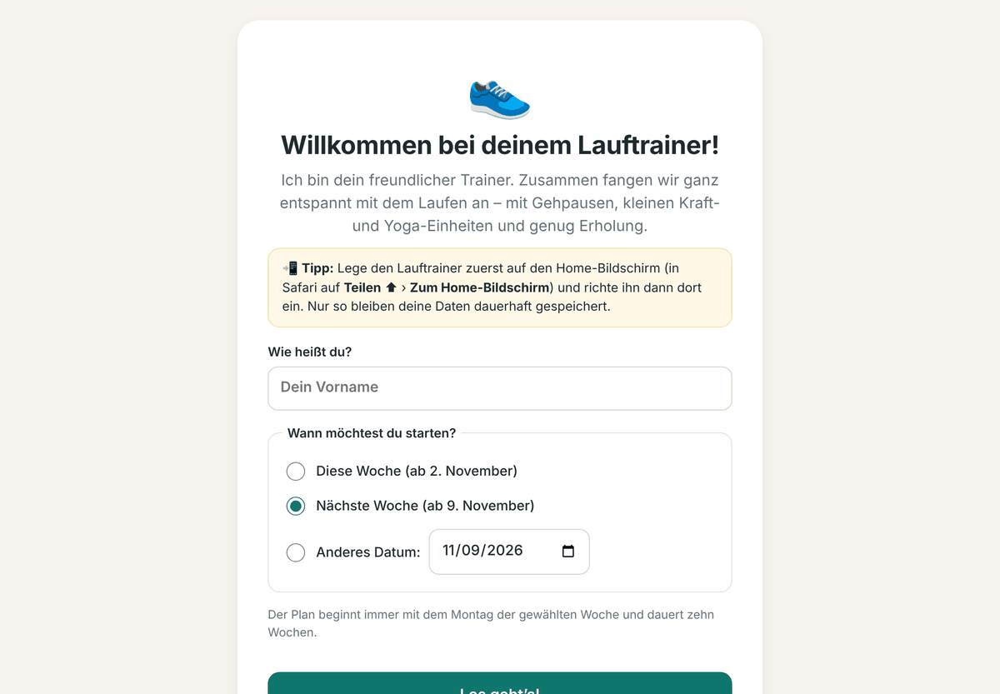

# Die Bedienung

Im Querformat findest du das Menü links, im Hochformat unten: **Übersicht**, **Plan**, **Übungen**, **Verlauf** und **Einstellungen**.

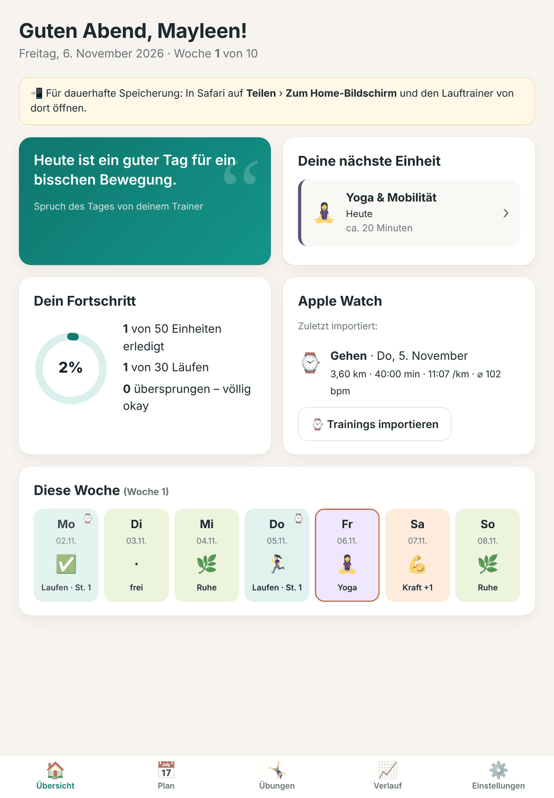

## Übersicht

Die Übersicht zeigt dir den Spruch des Tages, deine nächste Einheit, deinen Fortschritt, dein letztes Apple-Watch-Training und die aktuelle Woche. Ein Tipp auf einen Tag öffnet die Einheit. Ein kleines ⌚ am Tag bedeutet: Dort gibt es ein Training von der Apple Watch.

## Trainingsplan

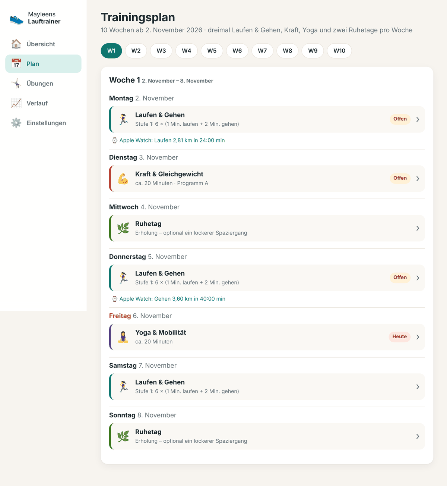

Jede Woche besteht aus:

| Tag | Einheit |
|---|---|
| Montag, Donnerstag, Samstag | **Laufen & Gehen** – 5 Min. Aufwärmen, Lauf-/Geh-Intervalle, 5 Min. Ausgehen |
| Dienstag | **Kraft & Gleichgewicht** – ca. 20 Minuten (Programm A und B im Wechsel) |
| Freitag | **Yoga & Mobilität** – ca. 20 Minuten |
| Mittwoch, Sonntag | **Ruhetag** – optional ein lockerer Spaziergang |

Mit den Knöpfen **W1, W2 …** oben springst du zwischen den Wochen.

Die Laufeinheiten sind in 18 Stufen eingeteilt: von *6 × (1 Min. laufen + 2 Min. gehen)* bis *30 Min. am Stück*. Bei jeder Einheit hast du diese Knöpfe:

- **Erledigt** – du wirst gefragt, wie es sich angefühlt hat, und kannst eine Notiz schreiben.
- **Überspringen** – völlig in Ordnung. Der Trainer macht dir keine Vorwürfe.
- **Verschieben** – wähle einen anderen Tag.
- **Zurücksetzen** – falls du dich vertippt hast.

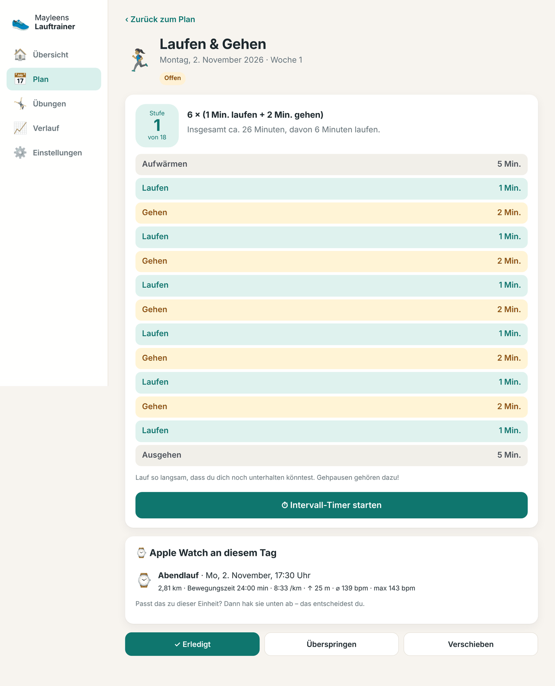

## Wie sich der Plan anpasst

Nach jeder erledigten Einheit sagst du, wie sie sich angefühlt hat:

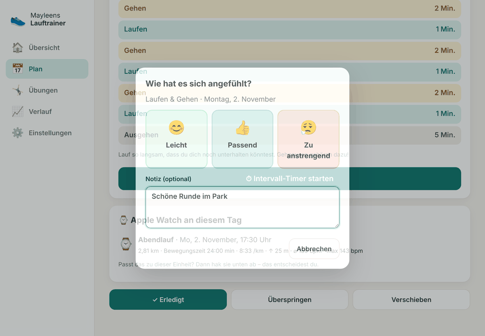

- **Zu anstrengend:** Der nächste Lauf wird eine Stufe *leichter*, und die folgenden Läufe bleiben etwas zurückhaltender.
- **Passend:** Alles bleibt auf Kurs.
- **Leicht:** Erst nach *zweimal hintereinander* „leicht“ legt der Plan ein kleines bisschen zu.

Außerdem gilt immer: Der nächste Lauf ist **höchstens eine Stufe** schwerer als dein letzter erledigter Lauf. Hast du Einheiten ausgelassen, wird es also nicht plötzlich schwerer. Nach mehr als zwei Wochen Pause wird die letzte Stufe einfach wiederholt.

## Intervall-Timer

Bei Laufeinheiten gibt es den **Intervall-Timer**. Er zeigt die verbleibende Zeit, piept bei jedem Wechsel (mit 3-2-1-Vorwarnung) und sagt die Wechsel auch an. Mit **⏭** überspringst du einen Abschnitt.

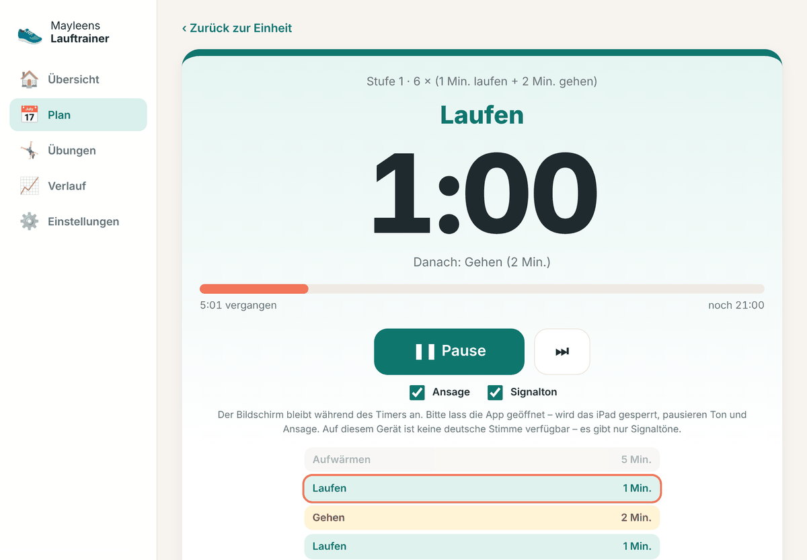

Gut zu wissen:

- Der Bildschirm bleibt während des Timers **an**. Wird das iPad gesperrt oder die App verlassen, pausieren Ton und Ansage. Die Zeit läuft aber korrekt weiter.
- Wenn du ohne iPad draußen läufst: Die **Trainings-App der Apple Watch** kann eigene Intervalle („Eigenes Training“) mit Lauf- und Gehphasen ansagen. Die Stufe aus dem Lauftrainer kannst du dort einmal anlegen.
- Kein Ton? Prüfe den **Lautlos-Schalter** bzw. das Kontrollzentrum und die Lautstärke.

## Übungen

Unter **Übungen** findest du alle Kraft-, Gleichgewichts-, Mobilitäts- und Yoga-Übungen mit Anleitung, Tipp und leichterer Variante. Mit den Knöpfen oben filterst du nach Bereichen.

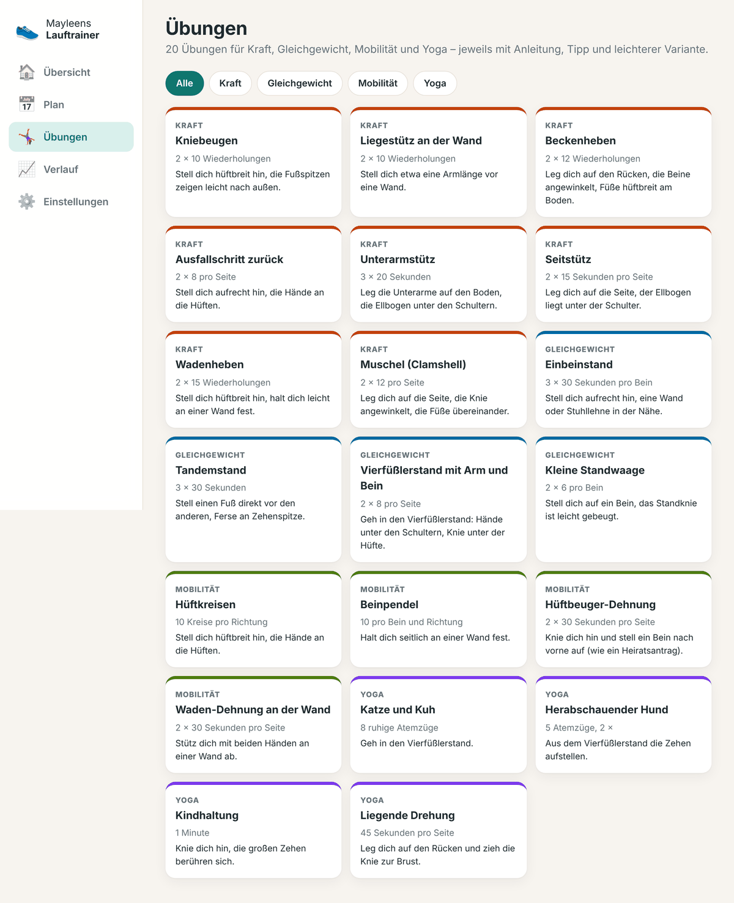

**Videos:** Der Lauftrainer bringt bewusst keine Videos mit. Möchtest du ein Video zu einer Übung, tippe auf **„Videolink eintragen“** und füge einen Link ein, der mit `https://` beginnt – zum Beispiel ein Video deiner Physiotherapeutin. Der Link wird nur auf dem iPad gespeichert. Das Video öffnet sich in Safari und braucht Internet.

## Verlauf

Unter **Verlauf** siehst du alle erledigten und übersprungenen Einheiten mit deinen Notizen sowie deine Apple-Watch-Trainings. Oben stehen deine gelaufenen Kilometer im aktuellen Monat und insgesamt.

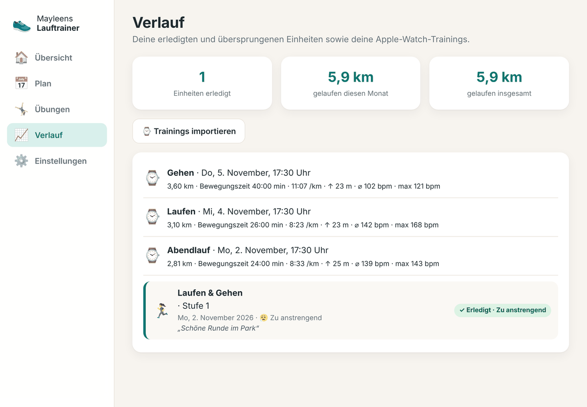

## Plan verlängern oder neu starten

Unter **Einstellungen › Profil & Plan** kannst du deinen Namen ändern, den Plan um **vier Wochen verlängern** oder ihn **neu starten** – z. B. nach einer längeren Pause. Vor einem Neustart wird automatisch eine Sicherung angelegt.

## Nach den 10 Wochen: 5 km, 10 km, 15 km

Nach den zehn Wochen läufst du 30 Minuten am Stück. Wenn du den Plan verlängerst, geht es weiter – **eine Stufe pro Woche**, Verlängern geht beliebig oft:

| Etappe | Stufen | Langer Lauf (Samstag) | Lockerer Lauf (Mo, Do) | ab Woche |
|---|---|---|---|---|
| Ziel **5 km** | 19–22 | 33 → 40 Min. | 30 Min. | 11 |
| Ziel **10 km** | 23–29 | 45 → 75 Min. | 30 → 40 Min. | 15 |
| Ziel **15 km** | 30–37 | 80 → 115 Min. | 40 → 50 Min. | 22 |

- **Montag und Donnerstag** sind lockere Läufe, am **Samstag** kommt der lange Lauf. Kraft, Yoga und Ruhetage bleiben wie gewohnt.
- Die **Ziel-Läufe** (Stufe 22, 29 und 37 am Samstag) sind mit 🎯 markiert. Die Minuten sind nur ein Richtwert: Lauf gemütlich, bis die Apple Watch 5, 10 oder 15 km zeigt. Bist du früher dort, darfst du aufhören.
- Deine Rückmeldungen wirken genauso wie bisher: „zu anstrengend“ macht es leichter, zweimal „leicht“ etwas schneller.
- Nach Stufe 37 bleibt der Plan dort – du hältst dann dein 15-km-Niveau.

# Apple Watch anbinden

Die Anbindung ist **freiwillig**. Der Lauftrainer funktioniert auch ohne Apple Watch vollständig.

## So funktioniert es

Apple erlaubt Web-Apps keinen direkten Zugriff auf die Health-Daten. Deshalb hilft die iPhone-App **HealthFit**: Sie legt jedes Apple-Watch-Training automatisch als Datei in deiner **iCloud Drive** ab. Dein iPad sieht diese Dateien über die Dateien-App, und der Lauftrainer liest sie ein, wenn du sie auswählst.

**Apple Watch → iPhone (Health) → HealthFit → iCloud Drive → iPad → Lauftrainer**

## Einmalig einrichten

1. Auf dem **iPhone**: Lade **HealthFit** aus dem App Store (einmaliger Kauf, kein Abo).
2. Öffne HealthFit und erlaube den Zugriff auf **Health** (Trainings, Herzfrequenz, Strecken).
3. Schalte in HealthFit die **automatische Übertragung zu iCloud Drive** ein und wähle als Format **FIT**. HealthFit legt dafür in iCloud Drive einen Ordner **„HealthFit“** an.
4. Auf dem **iPad**: Prüfe unter **Einstellungen › [dein Name] › iCloud**, dass **iCloud Drive** eingeschaltet ist – mit derselben Apple-ID wie auf dem iPhone.
5. Lauf wie gewohnt mit der **Trainings-App** der Apple Watch. Kurz nach dem Training liegt die Datei in iCloud Drive.

> HealthFit ist eine App eines unabhängigen Entwicklers. Die genaue Bezeichnung der Menüpunkte kann sich mit neuen Versionen ändern.

## Trainings importieren

1. Tippe im Lauftrainer auf **„⌚ Trainings importieren“** (Übersicht, Verlauf oder *Einstellungen › Apple Watch*).
2. Das Dateien-Fenster öffnet sich. Wähle **iCloud Drive › HealthFit**.
3. Tippe oben rechts auf **„Auswählen“**, markiere die neuen Dateien (oder einfach alle) und tippe auf **„Öffnen“**.
4. Der Lauftrainer zeigt, wie viele neue Trainings übernommen wurden. **Doppelte werden automatisch erkannt** – du kannst also ruhig immer alle auswählen.

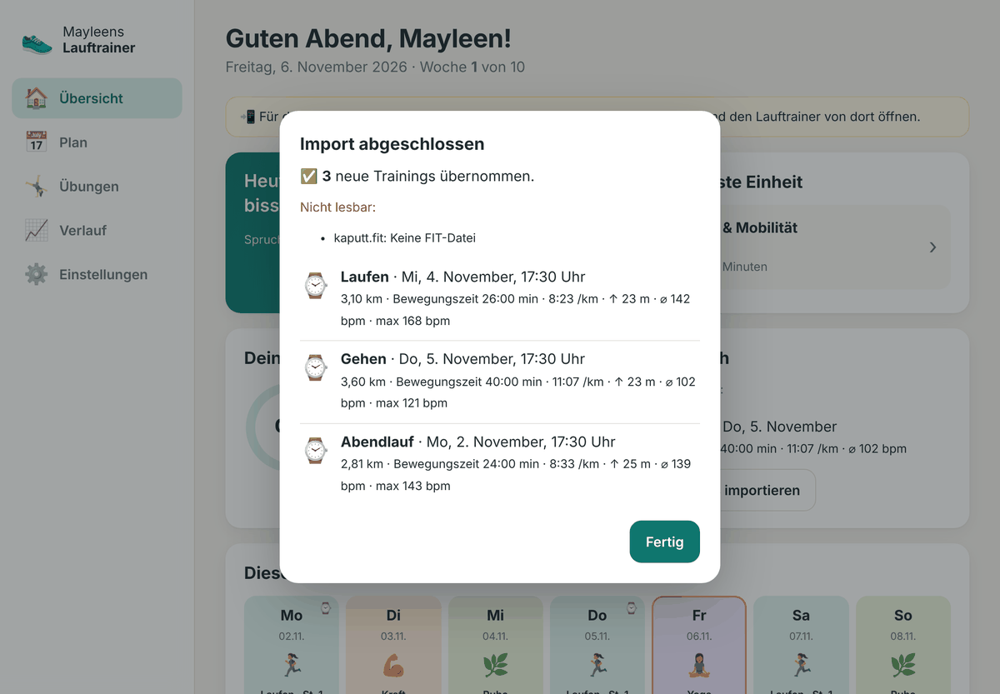

Gespeichert werden: Datum, Uhrzeit, Sportart, Distanz, Bewegungszeit, Gesamtzeit, Höhenmeter, Durchschnittstempo und – falls vorhanden – durchschnittliche und maximale Herzfrequenz. Die **GPS-Strecke wird nicht gespeichert**.

Findet der Lauftrainer an einem Lauftag ein Apple-Watch-Training, zeigt er es bei der Einheit und im Plan an. **Das Abhaken der Einheit bleibt deine Entscheidung.**

FIT- und GPX-Dateien werden beide unterstützt. FIT enthält meist mehr Werte (z. B. Herzfrequenz), deshalb ist es die Empfehlung.

## Trainings entfernen

Unter **Einstellungen › Apple Watch › Importierte Trainings entfernen** löschst du alle übernommenen Trainings aus dem Lauftrainer. In Health, auf der Watch und in iCloud Drive bleiben sie erhalten.

# Wo liegen meine Daten?

Alle Daten liegen **nur auf deinem iPad**, im Speicher der Home-Bildschirm-App (technisch: IndexedDB). Es gibt keinen Datenordner, den du von Hand öffnen musst.

Unter **Einstellungen › Daten & Sicherung › Speicher** siehst du, ob die App als Home-Bildschirm-App geöffnet ist und ob der Speicher dauerhaft geschützt ist.

> **Achtung:** Wenn du das Lauftrainer-Symbol vom Home-Bildschirm **löschst**, löscht das iPad auch die Daten der App. Lege vorher eine Sicherung an.

# Sichern, Wiederherstellen und Löschen

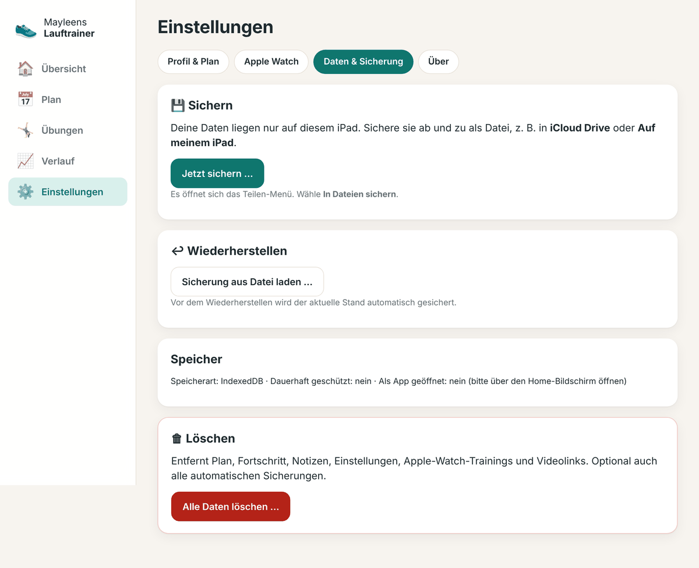

## Sichern

1. Öffne **Einstellungen › Daten & Sicherung**.
2. Tippe auf **„Jetzt sichern …“**. Das Teilen-Menü öffnet sich.
3. Wähle **„In Dateien sichern“** und dann z. B. **iCloud Drive** oder **Auf meinem iPad**. Es entsteht eine Datei wie `Lauftrainer-Sicherung-2026-11-06_19-30.json`.

Zusätzlich legt der Lauftrainer **automatische Sicherungen in der App** an – bei jeder manuellen Sicherung, vor einem Neustart des Plans, vor dem Wiederherstellen und vor dem Löschen. Die letzten zehn findest du in der Liste.

Hast du länger nicht gesichert, erinnert dich die Übersicht freundlich daran.

> Eine Sicherung in **iCloud Drive** ist am sichersten: Sie überlebt auch ein verlorenes oder neues iPad.

## Wiederherstellen

- **Aus der Liste:** Tippe bei der gewünschten automatischen Sicherung auf **„Wiederherstellen“**.
- **Aus einer Datei:** Tippe auf **„Sicherung aus Datei laden …“** und wähle die `.json`-Datei. Das geht auch schon auf dem Willkommensbildschirm (*„Ich habe eine Sicherung“*) – praktisch bei einem neuen iPad.

Vor dem Wiederherstellen wird der aktuelle Stand automatisch gesichert – du kannst also nichts verlieren.

## Löschen

**„Alle Daten löschen …“** entfernt Plan, Fortschritt, Notizen, Apple-Watch-Trainings und Videolinks. Optional auch alle automatischen Sicherungen. Zur Bestätigung musst du **LÖSCHEN** eintippen.

# Aktualisieren

Neue Versionen spielt Klaus auf dem Webserver ein. Der Lauftrainer lädt sie beim nächsten Öffnen mit Internet automatisch im Hintergrund und meldet: *„Eine neue Version ist da. Jetzt laden“*. Deine Daten bleiben dabei erhalten.

Welche Version installiert ist, siehst du unter **Einstellungen › Über**.

# Häufige Probleme und Lösungen

**Meine Daten sind weg.**
Wahrscheinlich wurde der Lauftrainer in Safari statt über das Home-Bildschirm-Symbol benutzt – das sind zwei getrennte Speicher. Öffne ihn über das Symbol. Hast du eine Sicherungsdatei, lade sie unter *Einstellungen › Daten & Sicherung*.

**„Zum Home-Bildschirm“ fehlt im Teilen-Menü.**
Scrolle im Teilen-Menü nach unten. Fehlt der Eintrag weiterhin, öffne die Seite in **Safari** (nicht in einer anderen App) und prüfe, ob die Adresse mit `https://` beginnt.

**Im Dateien-Fenster gibt es keinen HealthFit-Ordner.**
Prüfe, ob in HealthFit die Übertragung zu iCloud Drive eingeschaltet ist und ob iPhone und iPad dieselbe Apple-ID mit eingeschaltetem iCloud Drive nutzen. Öffne einmal die **Dateien-App** auf dem iPad und warte, bis iCloud Drive synchronisiert hat.

**Ein Training fehlt.**
HealthFit überträgt meist kurz nach dem Training. Öffne HealthFit auf dem iPhone einmal, dann lädt es ausstehende Trainings hoch. Importiere danach erneut – Doppelte werden übersprungen.

**„Nicht lesbar“ beim Import.**
Die Datei ist keine FIT- oder GPX-Datei oder wurde nicht vollständig aus iCloud geladen (Wolken-Symbol). Tippe die Datei in der Dateien-App einmal an, damit sie geladen wird, und importiere erneut.

**Der Intervall-Timer spricht nicht.**
Die Ansage nutzt die Sprachausgabe des iPads. Falls keine deutsche Stimme vorhanden ist, ertönen nur die Signaltöne. Prüfe Lautstärke und Lautlos-Modus. Stimmen findest du unter *Einstellungen › Bedienungshilfen › Gesprochene Inhalte › Stimmen*.

**Der Timer piept nicht, wenn das iPad gesperrt ist.**
Das ist eine Einschränkung von iPadOS für Web-Apps. Lass die App während des Laufens geöffnet – der Bildschirm bleibt dann automatisch an.

**Der Lauftrainer startet ohne Internet nicht.**
Er muss mindestens einmal mit Internet geöffnet worden sein. Danach startet er auch offline.

# Datenschutz und Sicherheit

- **Nur lokal:** Plan, Fortschritt, Notizen und Trainings werden ausschließlich auf dem iPad gespeichert. Es gibt kein Konto und keinen Server, der Daten speichert.
- **Keine Weitergabe:** Es werden keine Daten an Anthropic/Claude, Hosting-, Analyse- oder Werbedienste gesendet. Die App lädt keine fremden Schriften oder Skripte. Ein Sicherheitsfilter (Content Security Policy) verhindert solche Verbindungen technisch.
- **Apple Watch nur auf Wunsch:** Trainings werden nur gelesen, wenn du Dateien auswählst. Die GPS-Strecke wird nicht gespeichert.
- **Der Webserver** liefert nur die Programmdateien aus. Er sieht keine Trainingsdaten.

# Bereitstellen (für Klaus)

Der Lauftrainer ist eine statische Web-App. Safari braucht **HTTPS**, damit die App offline läuft und auf den Home-Bildschirm kann.

**Variante 1: GitHub Pages (kostenlos)**

1. Neues Repository anlegen, z. B. `lauftrainer` (privat oder öffentlich).
2. Den **Inhalt** des Ordners `MayleensLauftrainer-iPad` hochladen (`index.html` muss im Hauptordner liegen).
3. *Settings › Pages › Source: Deploy from a branch*, Branch `main`, Ordner `/ (root)`.
4. Nach ein bis zwei Minuten ist die App unter `https://<benutzer>.github.io/lauftrainer/` erreichbar.

> Hinweis: Eine GitHub-Pages-Seite ist öffentlich abrufbar. Das ist unkritisch, weil sie nur das Programm enthält und keine persönlichen Daten – Name und Trainings entstehen erst auf dem iPad.

**Variante 2: Eigener Server** (z. B. Proxmox-VM, Home Assistant, NAS)

Beliebiger Webserver (nginx, Caddy …) mit gültigem Zertifikat. Wichtig: `.webmanifest` als `application/manifest+json` und `.js` als `text/javascript` ausliefern. Bei Caddy reicht:

```
lauftrainer.example.de {
    root * /srv/lauftrainer
    file_server
}
```

**Updates:** Dateien ersetzen und in `sw.js` die Versionsnummer in `CACHE` erhöhen. Das iPad lädt die neue Version beim nächsten Öffnen.

**Testen am PC:** Im Ordner `python -m http.server 8000` starten und `http://localhost:8000` öffnen.

# Ordnerübersicht

```
MayleensLauftrainer-iPad\
├── index.html               Startseite der App
├── manifest.webmanifest     App-Beschreibung für den Home-Bildschirm
├── sw.js                    Offline-Speicher der Programmdateien
├── css\app.css              Gestaltung
├── js\
│   ├── app.js               Oberfläche
│   ├── plan.js              Trainingsplan und Anpassung
│   ├── data.js              Laufstufen, Übungen, Sprüche
│   ├── importer.js          FIT-/GPX-Import (Apple Watch über HealthFit)
│   ├── timer.js             Intervall-Timer
│   └── db.js                lokale Speicherung
├── icons\                   App-Symbole
└── Handbuch\
    ├── Handbuch-Mayleens-Lauftrainer.md
    └── bilder\              Bildschirmfotos
```

Viel Freude beim Laufen – und denk daran: **Jeder Schritt zählt.**
